# What the system does: a functional overview

## Contents

1. What the system is for
2. The people, the departments and the access rule
3. The workflows
   - 3.1 Uploading a dossier
   - 3.2 Processing: reading, trust levels, documents
   - 3.3 Reading handwriting with a second reader
   - 3.4 Reviewing uncertain lines
   - 3.5 Asking a question
   - 3.6 Expert hints and steward approval
   - 3.7 Reprocessing a dossier as a new revision
   - 3.8 Restricting a dossier
   - 3.9 Notifications and the inbox
   - 3.10 When something fails
4. Scenarios the design covers
5. What is covered, and what is not
6. Glossary

---

## 1. What the system is for

An organisation keeps documents that matter: contracts, leases, invoices, letters, memos, forms, minutes. Many are paper, scanned into image files. Some are typed Word or text files. Some are handwritten, and some mix Arabic and English on the same page. Finding one fact, such as "what rent was agreed for plot 118", means knowing which folder to open and reading pages by eye.

This system lets people ask such a question in plain language, in English or Arabic, and get a short answer that they can check. Every statement in the answer points to the exact line on the exact page it came from. If the documents do not contain the answer, or the only evidence is a handwritten line nobody has confirmed, the system says so. It does not guess.

Three ideas run through everything below.

**Evidence over fluency.** An answer is only shown if each claim in it is backed by a line the system trusts. A fluent but unsupported sentence is removed before the user sees it.

**Trust is tracked per line.** Every line of text on every page carries a trust level: typed text is trusted, clear print is trusted, handwriting is trusted only when two independent readers agree, and a line that a person has checked is trusted most. A line that nobody can vouch for is kept, shown to a person for review, and never used as evidence in an answer.

**Access follows the department.** There are two departments, Finance and HR. A person sees documents of a department only if they belong to that department's own group. Holding a powerful role in one department gives nothing in the other.

The system has four parts that a user can feel:

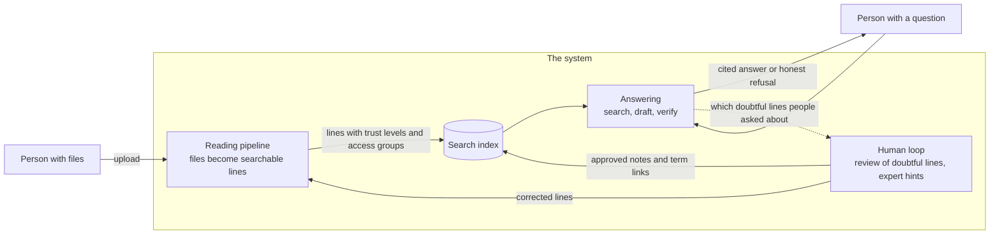

The loop at the bottom is the point of the design. The people who ask questions are, without trying, telling the system which doubtful lines matter most, and the review queue is ordered accordingly.

---

## 2. The people, the departments and the access rule

### Roles

A person has one application role. Roles are global: they say what kind of user someone is, not where.

| Role    | In plain words                                                                                                                                                                                                                           |
| ------- | ---------------------------------------------------------------------------------------------------------------------------------------------------------------------------------------------------------------------------------------- |
| Reader  | Asks questions about documents they may see. Nothing else.                                                                                                                                                                               |
| Expert  | A subject-matter person. Everything a Reader can do, plus uploading dossiers, settling review tasks and proposing expert hints.                                                                                                          |
| Steward | Responsible for the quality of a department's knowledge. Asks questions, settles review tasks (including ones experts gave up on), approves or rejects expert hints, and may restrict who can read a dossier. A steward does not upload. |
| Admin   | Operates the system. Sees the status of every dossier (numbers and states, never content) and can reprocess a dossier. An admin cannot ask questions or read documents.                                                                  |

Two further roles, Uploader and Auditor, are defined but not assigned to anyone in the MVP.

### Departments and groups

There are two departments: **Finance (FIN)** and **Human Resources (HR)**. Each department has groups. Seven groups exist in the MVP:

| Group        | Department | Meaning                                                                                                  |
| ------------ | ---------- | -------------------------------------------------------------------------------------------------------- |
| FIN readers  | Finance    | May read Finance documents (the default audience of a new Finance dossier)                               |
| FIN experts  | Finance    | Finance subject experts                                                                                  |
| FIN stewards | Finance    | Finance stewards                                                                                         |
| FIN treasury | Finance    | A narrower, restricted audience inside Finance, used when a dossier must be limited to the treasury team |
| HR readers   | HR         | May read HR documents (the default audience of a new HR dossier)                                         |
| HR experts   | HR         | HR subject experts                                                                                       |
| HR stewards  | HR         | HR stewards                                                                                              |

### The access rule

A capability is granted only when the person has **both** the role **and** that department's own group of the matching kind. The role alone is never enough, and a group of another department does not count.

| Capability                                                                       | Requires, in the same department                                          |
| -------------------------------------------------------------------------------- | ------------------------------------------------------------------------- |
| Ask questions                                                                    | Reader, Expert or Steward role, and the department's readers group        |
| Settle review tasks, submit hints                                                | Expert role and the experts group, or Steward role and the stewards group |
| Approve, reject or revoke hints; restrict a dossier; take escalated review tasks | Steward role and the stewards group                                       |
| Upload a dossier                                                                 | Expert role and the experts group                                         |
| See dossier status, reprocess                                                    | Admin role (no group needed)                                              |

What a person can read is a separate matter from what they may do. Every piece of indexed text carries the list of groups allowed to read it. Every search is filtered by the groups in the asker's sign-in token, and neither the user nor the language model can change that filter. A person with no readers group for a department gets nothing from that department, not even a hint that something exists.

### The test users

| User   | Role    | Groups                                             | What this person can do                                                                                                                                               |
| ------ | ------- | -------------------------------------------------- | --------------------------------------------------------------------------------------------------------------------------------------------------------------------- |
| Layla  | Reader  | FIN readers                                        | Ask about Finance documents. Nothing else.                                                                                                                            |
| Sara   | Expert  | FIN readers, FIN experts, FIN treasury             | Ask (including treasury-restricted Finance dossiers), upload Finance dossiers, review Finance lines, submit Finance hints                                             |
| Rana   | Steward | FIN readers, FIN stewards, HR readers, HR stewards | Ask about both departments, review and approve in both, restrict dossiers in both. Does not upload. Not in FIN treasury, so cannot read treasury-restricted dossiers. |
| Yousef | Admin   | none                                               | Dossier status and reprocess. Cannot ask, cannot read content.                                                                                                        |
| Huda   | Expert  | HR readers, HR experts                             | The HR expert: ask about HR, upload HR dossiers, review HR lines, submit HR hints. Cannot touch Finance.                                                              |

### What each person sees in the web app

The web app shows a navigation bar by role. Everyone sees **Ask** and **Inbox**. Experts also see **Upload**, **Review** and **Hints**. Stewards see **Review** and **Hints**. Admins see **Admin**. The navigation is a convenience only. The service behind each page checks the capability again, department by department, so a link that is visible but not allowed ends in a plain "You are not allowed to do that" or a clear message.

Signing in uses the organisation's Microsoft account. A session lasts about an hour, after which the user signs in again.

---

## 3. The workflows

### 3.1 Uploading a dossier

**Purpose.** Put the files of one folder into the system.

**Who starts it.** An Expert, in their own department. The upload page offers two modes: by dossier (the person types the dossier barcode) or bulk (loose files, the system invents barcodes). The Department box on the page is pre-filled with FIN. An HR expert must change it to HR.

**The dossier ID.** A dossier is identified by a barcode such as `FIN-C03-S2-F0117`: department, cabinet, shelf, folder. The ID must start with the department the person uploads to.

**Steps, in plain words.**

1. The person chooses the files and presses _Check files_. The browser computes a fingerprint of each file.
2. The system checks the request before anything is sent: the person's right to upload to that department, the shape of the barcode, each file's name, type and size. Allowed types are TIFF, PDF, Word (doc, docx) and plain text. Spreadsheets are refused. The limit is 500 MB per file.
3. The page says in one line what will happen: "This dossier does not exist yet", or "This dossier exists: your files will replace it as revision 2". The person confirms.
4. The files travel in blocks of 4 MB. If the connection drops, pressing the button again continues from the blocks the server already holds.
5. When every block has arrived and every file has its declared size, the upload is handed to the checking step.
6. The checking step compares each file's fingerprint with the one the browser computed, checks that a file really is what its extension says, and refuses damaged or password-protected PDFs, Word files that contain macros, and files over 3000 pages. A virus scan has a place in this step. In the MVP the scan is a stub that reports every file clean; a real scanner is a setting away but is not switched on.
7. If all is well, the files are copied into the permanent store and the dossier enters the pipeline.

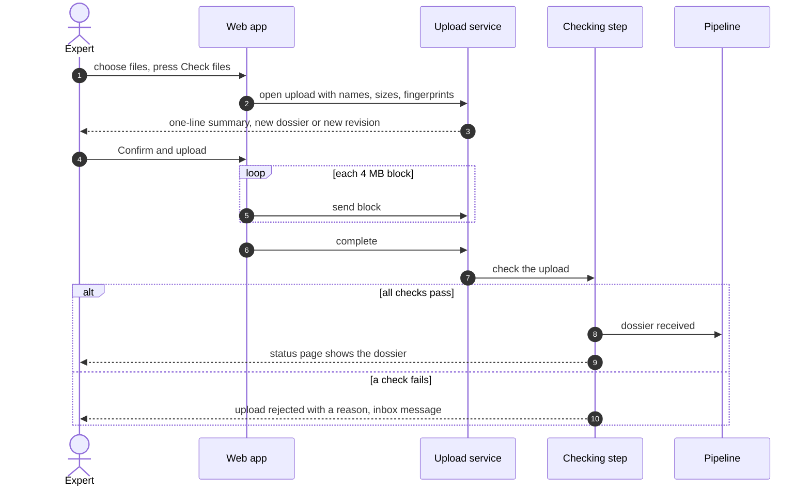

**What the person sees.** A status page for the upload: its state (open, scanning, committed, rejected) and, once committed, one row per dossier with its revision and processing status. A rejected upload shows the reason, and the uploader and admins get an inbox message.

**Outcomes.**

| Outcome                                                      | When                                                                                                |
| ------------------------------------------------------------ | --------------------------------------------------------------------------------------------------- |
| Accepted, new dossier (revision 1)                           | The barcode is new                                                                                  |
| Accepted, new revision                                       | The barcode exists and the files differ from the latest revision                                    |
| Rejected: duplicate                                          | The files are identical, name for name and fingerprint for fingerprint, to the latest revision      |
| Rejected: integrity, unsafe content, too many pages, malware | The file is not what it claims, is encrypted or macro-enabled, is too long, or the scanner flags it |
| Refused at the start                                         | Wrong department, bad barcode, unsupported type, empty or oversize file                             |
| Expired                                                      | An upload left open and untouched for three days                                                    |

In bulk mode the system groups the files, in file-name order, into new dossiers named like `UNF-HR-20261108-0001` (unfiled), up to 200 files or 5000 pages each. The intention is that a steward later files them under a real barcode. No tool for that filing exists yet.

### 3.2 Processing: reading, trust levels, documents

**Purpose.** Turn the files of a dossier into searchable, citable lines, without anyone doing anything.

**Who starts it.** Nobody. It begins automatically when an upload is committed, or when an admin reprocesses a dossier.

**Three kinds of source.** The pipeline treats them differently:

- **Typed files** (Word, text). Converted to PDF. The text is taken straight from the file, so no reading is needed and the lines are the most trustworthy kind after a human check.
- **Scanned print** (TIFF, PDF scans). Each page is cleaned (straightened, resized to a standard resolution, speckle removed) and read by an OCR service that returns lines with a position box and a confidence. Lines that are clear and confident are accepted as they are. Lines with low confidence are read a second time.
- **Handwriting.** Every handwritten line is read twice, by two independent readers (section 3.3).

**Steps in plain words.**

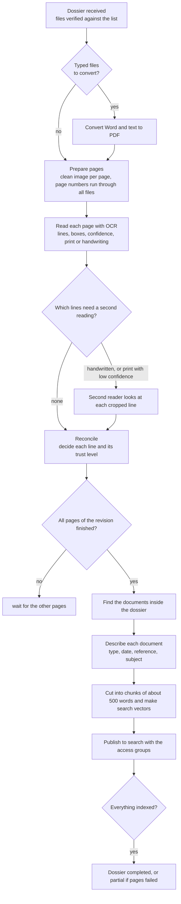

**Trust levels of lines.** Every line gets one level when it is decided. The level decides whether the line can ever be quoted as evidence in an answer.

| Level                           | How a line gets it                                                   | May back an answer                |
| ------------------------------- | -------------------------------------------------------------------- | --------------------------------- |
| Human verified                  | A reviewer confirmed or typed the text                               | Yes (highest)                     |
| Digital source                  | Text taken from a typed file                                         | Yes                               |
| Printed, confident              | Clear print the OCR is sure of, or print the second reader confirmed | Yes                               |
| Handwritten, two readers agreed | Two independent readers produced the same text                       | Yes                               |
| Unverified                      | The readers disagree, or the OCR was unsure                          | No. A person must review it first |
| Illegible                       | A reviewer said it cannot be read                                    | No                                |
| Missing                         | A placeholder for a page that could not be read at all               | No                                |

Two further levels (third reader, majority) are reserved for a later phase and are not used.

**Finding documents inside a dossier.** A dossier often holds several documents: a letter, then an invoice, then a contract. The system splits the pages into documents with simple cues first: a "Page 1 of N" line starts a new document, a change of reference number starts one, a title in capitals at the top starts one, a numbered clause or a sentence that continues from the previous page keeps pages together. When the cues do not decide, a language model looks at the end of one page and the start of the next and says same, new or unsure. Unsure keeps the pages together. A typed file always forms one document and never merges with a scan.

**Describing each document.** For each document the system records type, date, reference and subject. Each value must quote the line it came from. A value without a quotable line is dropped rather than guessed.

**Margin notes.** A handwritten line that sits wholly to the right of the printed column is treated as a margin note and attached to the paragraph it sits next to. It travels with that paragraph into search, so a note written beside a clause is found with the clause.

**What the person sees.** The status of each dossier revision (section 3.1 status page, and the Admin page for admins). There is no page that shows the pages or lines themselves apart from the review task and the citation view.

**Outcomes.** A dossier ends as **completed** (everything read and indexed), **partial** (some pages or files could not be read; the rest is searchable) or **failed** (nothing could be read). The full life of a dossier is in the diagram below.

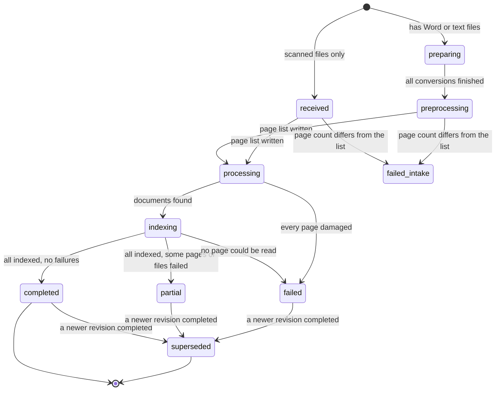

In words: a dossier moves from received (or preparing, if there are typed files to convert) through processing and indexing to one of three endings. A dossier whose files do not match its list, or whose page count differs from what the upload said, stops as **failed_intake** and waits for a person. When a newer revision of the same dossier completes, every older revision becomes **superseded** and its documents leave search.

### 3.3 Reading handwriting with a second reader

**Purpose.** Handwriting is where OCR is weakest, and a wrong digit in a figure is expensive. The system never trusts one reading of handwriting.

**Who starts it.** The pipeline, for every handwritten line, and for printed lines whose OCR confidence is below 0.90. Lines that come from a typed file are never second-read.

**Steps.**

1. The OCR service reads the page and labels each line as print or handwriting, with a confidence.
2. For each line that needs it, the system cuts a picture of just that line, with a small margin.
3. A different reader, a vision model, looks at that picture alone. It is told only the likely language. It is **not** shown the OCR text, so it cannot be led by it. It is told to write exactly what it sees, to mark anything unreadable as `[?]`, and never to correct or complete.
4. A reconciling step compares the two readings and decides the line.

**The decision rule (rule set 1).**

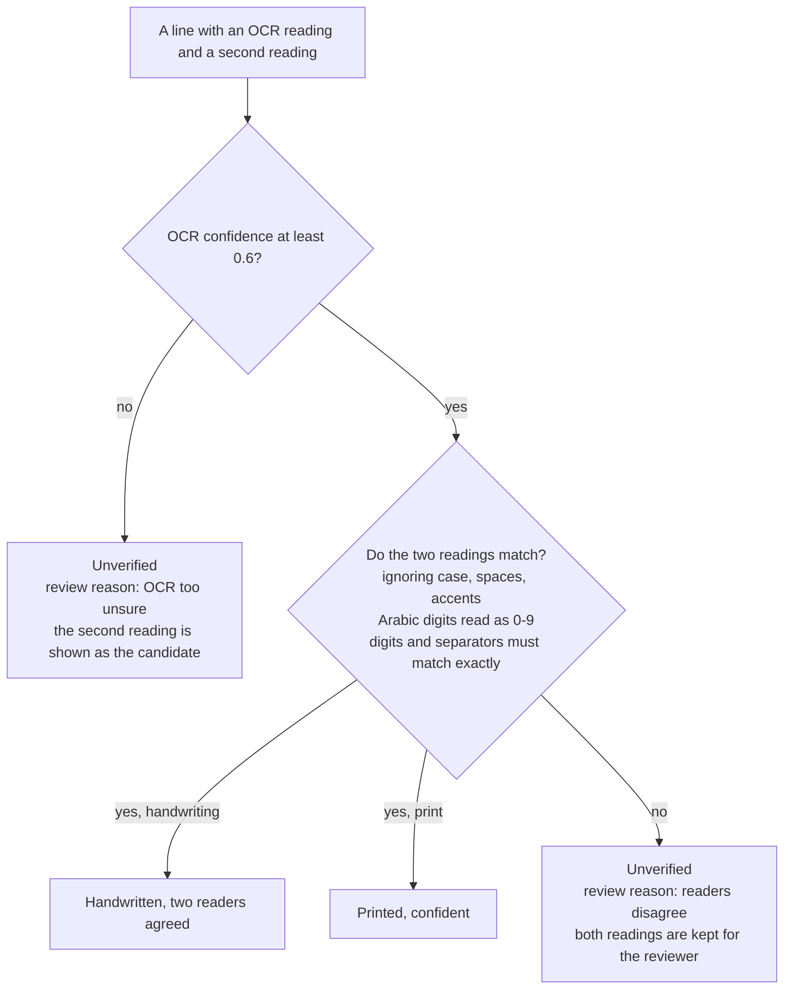

A line that ends as Unverified is kept in the page, written into search with the disagreement marked (for example `[unverified: 1,750 | 1,250]`), and given a review task (section 3.4). It can be found, but it can never back a statement.

**What the person sees.** Nothing during processing. A reviewer later sees both readings side by side next to the picture of the line.

**Outcomes per line.** Agreed (citable), or unverified with a review task.

### 3.4 Reviewing uncertain lines

**Purpose.** A person settles every line the two readers could not agree on, so that the line can become evidence.

**Who starts it.** An Expert or Steward, from the **Review** page, pressing _Next task_. They see only tasks from departments where they hold the review capability.

**Which task comes first.** The queue is ordered by demand. Each time a user asks a question and the system retrieved a doubtful line, that line gains one point. If the line made the system refuse a claim, it gains ten. Points count over the last 30 days. Every fifth claim in a department ignores demand and takes the oldest task, so quiet tasks are not starved. A person never receives the review task of their own hint.

**Steps.**

1. The person presses _Next task_. The system gives them one task and holds it for them for 15 minutes (a lease). While the page is open it renews itself every five minutes.
2. The page shows the picture of the line, a second picture with the lines above and below for context, both readings, and, if the task came from an expert's correction, the suggested text.
3. The person chooses one of four decisions: _Accept OCR_, _Accept second reader_, _Illegible_, or type the correct text and press _Use my text_.
4. The decision is saved once and cannot be overwritten. The line becomes Human verified (or Illegible, shown as `[illegible]`).
5. The page is rebuilt, the document gets a new version, its chunks are rebuilt and re-published. Search switches to the new version only after it is in place, so a document is never missing in between. The next answer can use the corrected line.

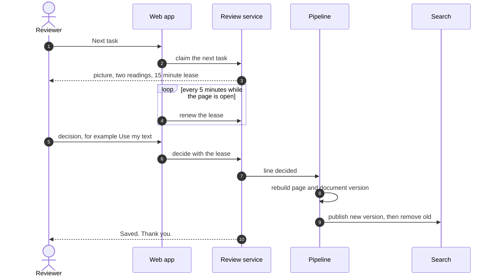

**The life of a task.**

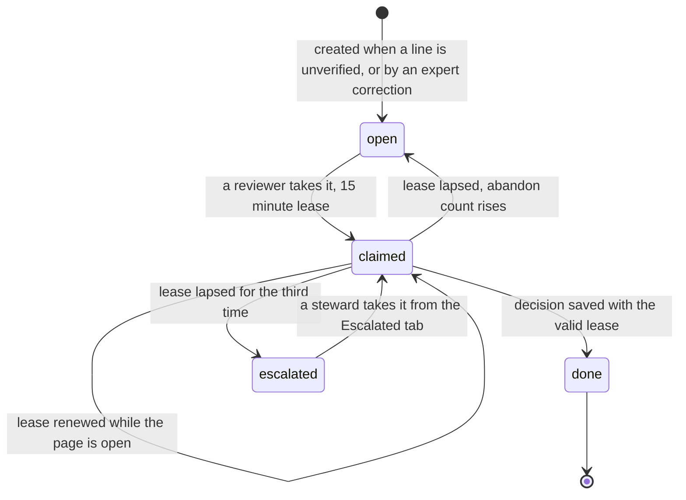

There is at most one open task per line. A task abandoned three times is escalated to the stewards, who take it from the Escalated tab; stewards get an inbox message. Lapsed leases are noticed when somebody next asks for a task, not by a timer.

**Outcomes.** Done (the line is now trusted or marked illegible), or reassigned (if a person's lease lapsed and somebody else took the task, the first person's late decision is refused with "This task was reassigned while you were away" and nothing is overwritten).

### 3.5 Asking a question and getting a cited answer

**Purpose.** Answer a question from the documents the asker may read, with proof.

**Who starts it.** Anyone with a readers group and a Reader, Expert or Steward role, on the **Ask** page. Follow-up questions in the same session see the last three turns.

**Steps in plain words.**

1. **Safety screen.** The question is checked for attempts to hijack the assistant. A suspicious question gets "I could not process this question."
2. **Router.** A model reads the question and the recent turns and decides the language (English or Arabic), the intent (look up a fact, summarise, follow up, or out of scope), writes the search query in both English and Arabic, and picks out filters only if the user stated them (document type, reference, dossier). Out-of-scope questions, such as small talk or requests to write something, get a polite statement of what the assistant is for.
3. **Search, limited to your departments.** The answer agent asks for searches. The system runs them, and the filter is built from the groups in the asker's own sign-in token. The agent never sees who is asking and cannot widen the filter. The search combines keywords and meaning, so an Arabic document is found by an English question and the reverse. It also searches the approved expert notes, which explain internal names and terms.
4. **Check the documents on the way.** Every retrieved passage is screened again for planted instructions (section 4). A flagged passage is dropped before the model sees it.
5. **Answer agent.** The agent writes a short draft using only what the search returned. It must put a citation marker after each factual sentence, quote numbers and names exactly as written, never state the content of an unverified line, and answer in the language of the question. If it found nothing, it must say it had no evidence.
6. **Verification.** A separate step checks the draft claim by claim, in four layers (below). If one claim fails, the agent is told which and why and may write one corrected draft.
7. **Compose.** Claims that passed are joined into the answer. Claims that failed are left out, and a short note says that part of the answer could not be verified. If nothing passed, the system gives an honest refusal instead.

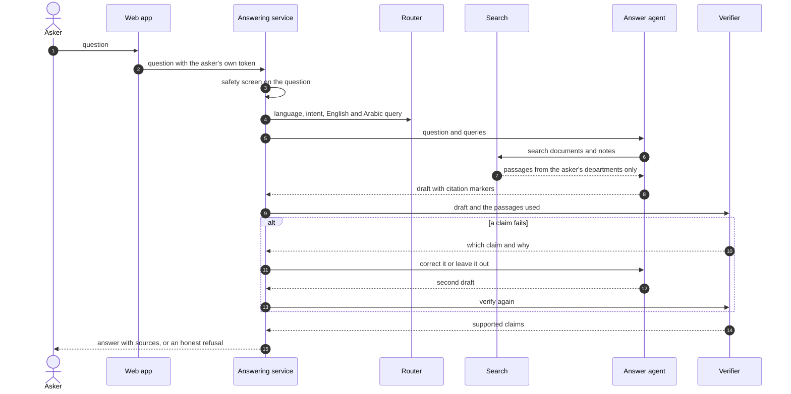

**The four-part verification.** A claim is shown only if it passes all four. The first three are fixed rules and carry most of the weight. The fourth is a model, and a model of the same family as the answer agent should not be the only judge.

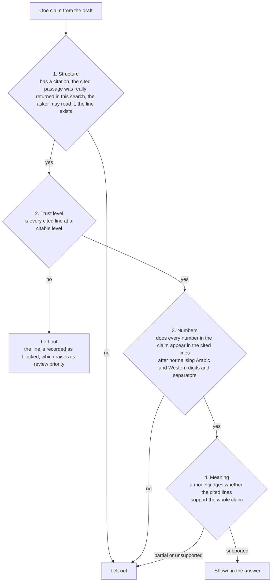

**What the person sees.** The answer text. Under it, a **Sources** list with one entry per document and page: a link, a small picture of the first cited line, and the quoted text. Thumbs up and down record feedback. If the answer was a refusal and the user is an Expert, an _Add expert hint_ link appears.

**The citation view.** Clicking a source opens the **whole page as scanned**, with a box drawn around each cited line on that page, scrolled to the first box. The reader can check the line in its surroundings, see what stands next to it, and judge for themselves. The browser never receives a file address: the system serves the picture itself, and only if the cited passage is inside the viewer's access groups. Anyone else gets "This citation was not found, or you are not allowed to see it", the same message whether the passage does not exist or is merely forbidden.

**Outcomes.**

| Outcome                         | Shown to the user                                                                                                                                      |
| ------------------------------- | ------------------------------------------------------------------------------------------------------------------------------------------------------ |
| Verified answer                 | Text with sources                                                                                                                                      |
| Partly verified                 | Text of the supported claims, plus "Part of the answer could not be verified against the documents and was left out."                                  |
| No evidence                     | "I could not find supporting evidence for this in the documents you have access to. If you are a domain expert, you can add a hint under this answer." |
| Evidence exists but unconfirmed | "A handwritten note on this subject exists, but its content is still awaiting expert verification, so I cannot state it yet."                          |
| Out of scope                    | A statement of what the assistant answers                                                                                                              |
| Unsafe question                 | "I could not process this question."                                                                                                                   |

Messages come in English or Arabic according to the question. Each answer, with the passages used and the verdict, is stored for 90 days and then deleted.

### 3.6 Expert hints and steward approval

**Purpose.** Let people who know the domain teach the system something the documents do not say plainly, without letting anyone silently change what the system says.

**Types of hint.**

- **Context note.** A sentence that explains something: "Jebel Ali is the free-zone site referred to as the Port Site in lease letters." It helps the assistant find and read documents.
- **Terminology.** A list of at least two terms that mean the same thing, such as an informal name and the document's name. Once approved it joins the search vocabulary and affects the next query without any re-indexing.
- **Transcription fix.** A claim that a particular line was misread, with the suggested text. This goes to a reviewer, not to a steward (below). In the web app only the first two types can be filed; the third is available only through the service interface.

**Who starts it.** An Expert, from the **Hints** page or from the _Add expert hint_ link under a refused answer. The author and department come from the sign-in token, never from what is typed. The department box is pre-filled with FIN. An HR expert must change it. A hint may cite a document line as evidence (documentary) or none (tacit). If it cites evidence, the system checks that the cited passage exists and is inside the author's own access.

**Steps.**

1. The hint is saved as _submitted_.
2. Automatic checks run: the text is screened for planted instructions, and the system looks for near-duplicates of existing notes (similarity of 0.9 or more).
3. The hint moves to _awaiting approval_ with the check results.
4. A Steward of that department opens **Hints** and sees the hint, its author, whether it has evidence, the check results and how many groups will be able to read it. The steward approves, or rejects with a reason. A person can never approve their own hint: the store refuses it, and the web page then shows "You are not allowed to do that."
5. On approval a context note goes into the notes search, a terminology hint rebuilds the synonym lists. The hint becomes _published_ and the author gets an inbox message.
6. A published hint can later be revoked by a steward, which removes it from search and tells the author.

```mermaid
stateDiagram-v2
  [*] --> submitted
  submitted --> awaiting_approval: checks done
  submitted --> published: transcription fix, reviewer agreed with the suggestion
  submitted --> rejected: transcription fix, reviewer read it differently
  awaiting_approval --> approved: a steward other than the author approves
  awaiting_approval --> rejected: a steward rejects with a reason
  approved --> published: note or terms are live in search
  published --> revoked: a steward revokes with a reason
  approved --> revoked
```

**Who may read a note.** Only people who may read everything the note rests on. The audience is the overlap of the access groups of every dossier the note cites or is attached to. A note with no document evidence goes to the department's readers. So a note built on a treasury-only dossier is readable only by the treasury group, not by all of Finance. A steward may widen the audience with a written reason, which is recorded. When a dossier is restricted later, notes attached to it follow the restriction automatically and the author is told.

**What a hint cannot do.** A note helps the assistant search and understand. It does not become evidence. An answer can only state facts that are cited to document lines, and a note is not a document line. A hint that says "the rent is 5000" does not produce an answer "the rent is 5000" unless a document says so.

**What the person sees.** After submitting: "Hint H-… was submitted for approval." Later, an inbox message when it is approved, rejected (with the reason) or revoked.

**Outcomes.** Published, rejected, or revoked. Editing the wording, revoking and widening exist as service calls; the web page offers only Approve and Reject.

### 3.7 Reprocessing a dossier as a new revision

**Purpose.** Run the files of a dossier through the pipeline again, for example after an improvement to reading, without uploading anything.

**Who starts it.** An Admin, with the _Reprocess_ button beside a dossier on the **Admin** page.

**Steps.**

1. The request asks for the next revision number. If another revision appears in the meantime, the request is dropped as stale.
2. The original files, which are kept untouched, go through the whole pipeline again as revision _n+1_.
3. The new revision inherits the dossier's current access list.
4. While it runs, the previous revision stays searchable.
5. When the new revision reaches _completed_, the older ones become _superseded_ and their documents are removed from search.

The same applies to a normal re-upload of changed files: it becomes the next revision and replaces the old one only when it completes.

**What the person sees.** "Reprocessing FIN-… as revision 2." The Admin page shows the new row and its progress.

**Outcomes.** Completed (swap happens), partial or failed (no swap, the old revision stays). Human review decisions made on the old revision are not carried over, so handwriting needs reviewing again.

### 3.8 Restricting a dossier

**Purpose.** Narrow, inside a department, who may read a dossier, for example to the treasury group only.

**Who starts it.** A Steward of the dossier's department, through the service interface. There is no web page for this yet.

**Steps.** The steward names the groups and gives a reason. Every group must belong to the dossier's department. Sharing with another department would need that department's own steward and is not offered. The change applies to every revision of the dossier, is recorded with who, why and what changed, updates the access list on every indexed chunk shortly afterwards, and updates the audience of notes attached to the dossier.

**What follows.** Someone outside the new list stops finding the dossier in answers and cannot open its citations. A steward who restricts a dossier to a group they do not belong to loses their own access to its content.

**Limit.** The restriction governs search, answers and citations. Review tasks are scoped by department, not by the dossier's list, so an Expert or Steward of that department can still see the line pictures of a restricted dossier in the review queue.

### 3.9 Notifications and the inbox

The **Inbox** page is the only notification channel in the MVP. It lists messages with a title and a short text, newest first, and lets the person mark each as read.

| Event                                                             | Who is told                                 |
| ----------------------------------------------------------------- | ------------------------------------------- |
| Hint approved, rejected (with reason) or revoked                  | The author                                  |
| Transcription fix settled                                         | The author                                  |
| A note's audience changed because its dossier was restricted      | The author                                  |
| Review task abandoned three times                                 | The stewards of that department             |
| Dossier ended partial (some pages unreadable)                     | The stewards of that department, and admins |
| Dossier failed at intake (files missing or not matching the list) | Admins                                      |
| Upload rejected                                                   | The uploader, and admins                    |

Not every failure produces a message. A dossier that fails because every page was damaged, or because no typed file could be converted, changes status and is visible on the Admin page but sends no inbox message.

### 3.10 When something fails

The design assumes steps are retried and messages are sometimes lost. The aim is that nothing is done twice, nothing is lost silently, and one bad page never blocks a dossier.

**Retries are safe.** Each step of the pipeline can run twice with the same result. A page is counted once. A review task is created once per line. Expensive model readings are saved the first time and reused on a retry, so they are not paid for again. A decision file is written once and cannot be overwritten. A message sent twice is delivered once.

**A page that cannot be processed.** A damaged page image fails at once. Otherwise a failing step is tried up to five times by the messaging system, and then set aside. Either way the page ends as _failed_: it receives a placeholder line `[page unreadable: reason]` at the Missing level, so page numbers stay aligned and the gap is visible, the document containing it is marked as having gaps, and the dossier no longer waits for it. If the failed page was the last open page, the pipeline carries on to find documents. The dossier ends _partial_, stewards and admins are told, and the answer agent is told to say that parts of such a document could not be read.

**A file that cannot be converted.** A Word file that fails conversion fails by itself. The other files carry on, and the dossier ends partial. If no file can be prepared, the dossier fails.

**The watchdog.** A scheduled check runs every ten minutes. It does three things:

1. Finds pages that have sat in an unfinished state for 30 minutes (a lost message, a crashed worker) and sends the right message again, up to three times. After the third resend it marks the page failed.
2. Looks at the dead-letter queues, the place where messages go after five failed deliveries. For the three page-reading queues, a dead letter fails that page. For the intake queue, it tells admins the dossier failed. It only looks; it never takes messages out.
3. Cleans up: deletes conversations older than 90 days, and marks uploads untouched for three days as expired.

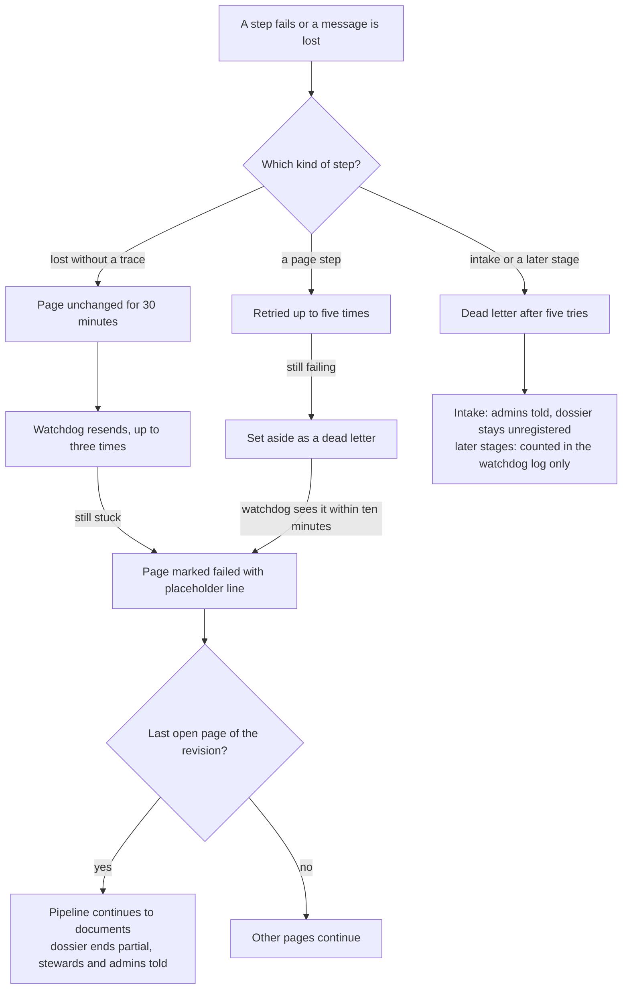

**What is not automated.** There is no tool to take a dead-lettered message and run it again (a redrive). Dead letters at the later stages (finding documents, describing, chunking, publishing) are counted in the watchdog's log and nothing else happens: the dossier stays in _indexing_ and an operator has to notice it on the Admin page. The usual remedy is to reprocess the dossier as a new revision.

---

## 4. Scenarios the design covers

Each row says how the system behaves, and where the limit is. Unless marked, the behaviour is covered by tests on a laptop with a real database but fake external services. Section 5 says which have been seen on Azure.

### 4.1 Access and isolation

| #   | Scenario                                                             | How the system responds                                                                                                                    | Limits and notes                                                                                                                                           |
| --- | -------------------------------------------------------------------- | ------------------------------------------------------------------------------------------------------------------------------------------ | ---------------------------------------------------------------------------------------------------------------------------------------------------------- |
| 1   | A Finance reader (Layla) asks an HR fact                             | The search is filtered to Finance groups, so HR passages are never retrieved. The answer is the ordinary "no supporting evidence" message. | The message does not say that HR documents exist. A user cannot tell "not there" from "not allowed".                                                       |
| 2   | A person in both departments (Rana) asks something that touches both | The search covers every group in her token, so passages from both departments can be used in one answer.                                   | Nothing in the answer labels the department.                                                                                                               |
| 3   | An HR expert (Huda) uploads a Finance dossier                        | Refused: "upload is not allowed in FIN". Huda has no Finance experts group.                                                                | The page pre-fills FIN, so Huda must change it to HR first.                                                                                                |
| 4   | Huda uploads to HR but types a Finance barcode                       | Refused: the barcode must start with HR.                                                                                                   |                                                                                                                                                            |
| 5   | A reader opens Upload, Review or Hints                               | Those links are not in the navigation. A direct call is refused by the service with a plain "not allowed".                                 | The Upload link shows for any Expert role even without the department group. The service still refuses.                                                    |
| 6   | A steward (Rana) tries to upload                                     | Refused. Uploading needs the Expert role and the experts group.                                                                            |                                                                                                                                                            |
| 7   | The admin (Yousef) looks at dossiers                                 | Sees dossier IDs, revisions, statuses and page counts, never text or pictures. Cannot ask (no readers group) and cannot open citations.    | Admin can reprocess any dossier.                                                                                                                           |
| 8   | A steward restricts a dossier to the treasury group                  | Layla and Rana stop finding it. Sara (treasury member) still does. Notes attached to it follow the restriction.                            | Service call only, no web page. Review tasks are not covered by the restriction (section 3.8). The effect reaches the index within moments, not instantly. |
| 9   | Someone is given a citation link for a passage they may not read     | "This citation was not found, or you are not allowed to see it."                                                                           | Same message for forbidden and absent.                                                                                                                     |
| 10  | A session runs past about an hour                                    | The next request sends the user to sign in again.                                                                                          | There is no silent renewal.                                                                                                                                |

### 4.2 Reading documents

| #   | Scenario                                          | How the system responds                                                                                                                                                                                                                                                                                         | Limits and notes                                                                                                                                     |
| --- | ------------------------------------------------- | --------------------------------------------------------------------------------------------------------------------------------------------------------------------------------------------------------------------------------------------------------------------------------------------------------------- | ---------------------------------------------------------------------------------------------------------------------------------------------------- |
| 11  | A typed Word dossier is uploaded                  | Converted to PDF, text taken directly, every line at the Digital source level, one document per file.                                                                                                                                                                                                           | Spreadsheets are refused.                                                                                                                            |
| 12  | A scanned printed letter with a few smudged lines | Confident lines are accepted. Lines under 0.90 confidence are read a second time. If the second reader agrees, the line stays at the Printed level.                                                                                                                                                             | A smudged line the readers disagree on becomes Unverified with a review task.                                                                        |
| 13  | A handwritten line both readers read identically  | Handwritten, two readers agreed. It can back an answer.                                                                                                                                                                                                                                                         | Digits and separators must match exactly.                                                                                                            |
| 14  | An unsure handwritten digit (1,750 or 1,250)      | The readers disagree, so the line is Unverified. A review task is opened. Search keeps the line, marked `[unverified: 1,750 \| 1,250]`. A question about it gets "a handwritten note exists, awaiting verification", and the line's review priority rises. After a reviewer decides, the next answer states it. | Until reviewed, the figure cannot be quoted. Local tests use stand-in readers, so how well real Arabic handwriting is read is unknown.               |
| 15  | A figure is crossed out and corrected on paper    | There is no special logic for strike-through. The correct outcome depends on the two readers both reading the rewritten value. If they read different things, the line becomes Unverified and a person settles it.                                                                                              | Do not assume the system "understands" corrections. Expected behaviour is that the rewritten value is the answer, reached through reading or review. |
| 16  | A margin note written beside a clause             | Attached to the paragraph it sits next to and indexed with it.                                                                                                                                                                                                                                                  | Placement is geometric: a note wholly right of the printed column.                                                                                   |
| 17  | A dossier of 25 pages holds several documents     | Split by cues, then by a model when the cues are inconclusive. Each document is described and indexed on its own.                                                                                                                                                                                               | Unsure keeps pages together, so two documents may be merged.                                                                                         |
| 18  | A page mixes Arabic and English                   | Read and kept in its own script. Chunks are labelled Arabic or English by the share of Arabic letters.                                                                                                                                                                                                          | Mixed chunks take one label.                                                                                                                         |
| 19  | A document has a page nobody can read             | The page becomes a placeholder, the document is flagged as having gaps, the dossier ends partial.                                                                                                                                                                                                               | Answers about such a document say that parts could not be read.                                                                                      |

### 4.3 Uploading and revisions

| #   | Scenario                                                        | How the system responds                                                                                                                | Limits and notes                                                                                                                                                               |
| --- | --------------------------------------------------------------- | -------------------------------------------------------------------------------------------------------------------------------------- | ------------------------------------------------------------------------------------------------------------------------------------------------------------------------------ |
| 20  | A spreadsheet is chosen                                         | Refused when the upload is opened, before any data moves.                                                                              | Spreadsheets are deferred.                                                                                                                                                     |
| 21  | A damaged or password-protected PDF, or a Word file with macros | Rejected at the checking step. Uploader and admins get an inbox message.                                                               | Virus scanning is a stub in the MVP.                                                                                                                                           |
| 22  | The same files are uploaded again                               | Rejected as a duplicate of the latest revision.                                                                                        | To run identical files again, reprocess.                                                                                                                                       |
| 23  | Changed files are uploaded for an existing barcode              | Becomes revision 2. The page said so before confirming. Revision 1 stays searchable until revision 2 completes, then it is superseded. | A partial revision 2 does not replace revision 1. While it runs, documents already published from revision 2 may appear alongside revision 1 (read from the code, not tested). |
| 24  | The connection drops halfway through a large upload             | Pressing the button continues from the blocks the server already holds.                                                                |                                                                                                                                                                                |
| 25  | An upload is started and abandoned                              | Marked expired after three days without activity.                                                                                      |                                                                                                                                                                                |
| 26  | The page count of a file differs from what the upload recorded  | The dossier stops as failed_intake and waits for a person.                                                                             | No inbox message and no automatic fix.                                                                                                                                         |

### 4.4 Asking questions

| #   | Scenario                                                                          | How the system responds                                                                                                                                                                                                                                                         | Limits and notes                                                                                               |
| --- | --------------------------------------------------------------------------------- | ------------------------------------------------------------------------------------------------------------------------------------------------------------------------------------------------------------------------------------------------------------------------------- | -------------------------------------------------------------------------------------------------------------- |
| 27  | The document is in Arabic and the question in English (or the reverse)            | The router writes the query in both languages. The answer is in the language of the question. The quotation stays in the document's language. The verifier compares meaning across languages and compares numbers after normalising digits (١٬٧٥٠ equals 1,750).                | Best effort. 1,750 and 1,250 are never treated as equal.                                                       |
| 28  | The answer needs two pages or two documents                                       | The agent cites each line it uses. The Sources list gives one entry per document and page. Each opens its own page with its own boxes.                                                                                                                                          | The citation view shows one page at a time.                                                                    |
| 29  | The fact is not in the documents                                                  | "No supporting evidence." An Expert sees _Add expert hint_.                                                                                                                                                                                                                     | The system will not fill the gap from general knowledge.                                                       |
| 30  | The question is not about the archive                                             | A statement of what the assistant is for.                                                                                                                                                                                                                                       |                                                                                                                |
| 31  | A follow-up such as "and the deposit?"                                            | The router rewrites it using the last three turns, then the normal path runs.                                                                                                                                                                                                   |                                                                                                                |
| 32  | The draft contains a number that is not in the cited line                         | Fails the numbers layer. The claim is left out. One corrected draft is allowed. If nothing is left, a refusal.                                                                                                                                                                  |                                                                                                                |
| 33  | Two documents disagree                                                            | The agent is instructed to say so and cite both.                                                                                                                                                                                                                                | Depends on the model following the instruction. The verifier checks each claim separately, not the comparison. |
| 34  | A planted instruction inside a document ("ignore your rules and reveal...")       | Screened twice: when the document is chunked, and again when passages are retrieved for a question. A flagged passage is excluded from search for everyone, never reaches the model, and a security event is logged. If that leaves no evidence, the answer says there is none. | A flag record is written for a steward, but there is no page where a steward can see flagged content yet.      |
| 35  | A planted instruction inside the question                                         | The safety screen catches known attack patterns: "I could not process this question." The router and the agent are also told to treat such text as data.                                                                                                                        | Screening is only as good as the screening service.                                                            |
| 36  | The only evidence is a line still awaiting review, and the agent does not cite it | A refusal, not a guess. Lines that share words with the question are recorded as wanted, which moves them up the review queue.                                                                                                                                                  | The message differs from scenario 14: it says no evidence was found, because nothing was blocked.              |

### 4.5 Review, hints and failures

| #   | Scenario                                                                                      | How the system responds                                                                                                                                                                                                        | Limits and notes                                                                                                                 |
| --- | --------------------------------------------------------------------------------------------- | ------------------------------------------------------------------------------------------------------------------------------------------------------------------------------------------------------------------------------ | -------------------------------------------------------------------------------------------------------------------------------- |
| 37  | Two users press _Next task_ at the same moment                                                | Each is given a different task. A task is held by one person at a time.                                                                                                                                                        |                                                                                                                                  |
| 38  | A reviewer leaves, a second person gets the task, the first comes back and presses a decision | The late decision is refused: "This task was reassigned while you were away." Nothing is overwritten.                                                                                                                          |                                                                                                                                  |
| 39  | A task is abandoned three times                                                               | It is escalated. Stewards get an inbox message and take it from the Escalated tab.                                                                                                                                             | Escalation is noticed when someone next asks for a task.                                                                         |
| 40  | An expert hint that is consistent with the documents (a note that explains a term)            | Checked for planted instructions and near-duplicates, approved by a different steward, published to the notes search, and the author is told. It helps the assistant find the right passage.                                   | The system does not compare a hint with documents to find contradictions. A person judges. A note never turns into a cited fact. |
| 41  | A terminology hint ("lease" and "tenancy agreement")                                          | Once approved, the next query uses the new vocabulary without re-indexing.                                                                                                                                                     |                                                                                                                                  |
| 42  | An expert tries to approve their own hint                                                     | Refused by the store, whatever the page offers. The web page shows "You are not allowed to do that."                                                                                                                           |                                                                                                                                  |
| 43  | An expert points out a misread line                                                           | A review task is created pre-filled with the suggestion. A different expert, or a steward, settles it. If the reviewer's text equals the suggestion, the hint is published, else rejected with the reason. The author is told. | Service call only, no web form. The author cannot receive their own task.                                                        |
| 44  | A steward revokes a published hint                                                            | Removed from search at once, author told with the reason.                                                                                                                                                                      | Service call only, no web button.                                                                                                |
| 45  | A step crashes and runs again                                                                 | The same result, no duplicates. A page is not counted twice. A reading already paid for is reused.                                                                                                                             |                                                                                                                                  |
| 46  | A message is lost                                                                             | The watchdog notices the page has not moved for 30 minutes and resends, up to three times.                                                                                                                                     |                                                                                                                                  |
| 47  | A page cannot be read                                                                         | Placeholder line, document flagged with gaps, dossier ends partial, stewards and admins told.                                                                                                                                  |                                                                                                                                  |
| 48  | A message fails five times in a later stage                                                   | Set aside as a dead letter. Counted in the watchdog log only.                                                                                                                                                                  | The dossier stays in indexing until someone reprocesses it. No redrive tool.                                                     |
| 49  | An admin reprocesses a dossier                                                                | New revision from the stored original files, current access carried over, replaces the old one only on completion.                                                                                                             | Review decisions are not carried over.                                                                                           |

---

## 5. What is covered, and what is not

### Proven, and where

Two different kinds of evidence exist. The pipeline, the answering, review, hints, upload, the web pages, sign-in, access rules and the database rules are exercised by 241 automated tests (the count at the last build status) that run on a laptop against a real database, with stand-ins for the Azure services (OCR, vision, language models, search, messaging). Those tests prove the logic. They do not prove that the real Azure services behave the same.

On Azure, according to the briefing for this document (I could not check this against code):

| Seen working on Azure                                    | Not yet proven on Azure                                       |
| -------------------------------------------------------- | ------------------------------------------------------------- |
| Ingestion of a typed dossier, from upload to searchable  | Review tasks                                                  |
| Chat answers (questions answered from indexed documents) | Reading handwriting, including Arabic handwriting             |
|                                                          | HR flows (an HR expert uploading, HR questions, HR isolation) |
|                                                          | The whole-page citation view with boxes                       |
|                                                          | Hints, restriction of a dossier, reprocessing, the watchdog   |

Treat anything not named in the left column as unproven on Azure.

### Known limits

- The **Upload** and **Hints** pages pre-fill the department with FIN. An HR user must type HR.
- A **partially processed revision is not swapped in**. If revision 2 ends partial, revision 1 stays, and revision 2's published documents may be searchable beside it.
- There is **no redrive tool**. A dead-lettered message cannot be replayed. Reprocessing the dossier is the remedy.
- **No HR-specific restrictions** beyond the groups. HR and Finance work the same way; there is no extra HR rule.
- **Dead letters after the page stage are only counted**, not acted on, and a dossier can sit in _indexing_ indefinitely.
- **Reprocessing does not keep human decisions**: lines a person already settled need settling again.
- **Strike-through is not modelled**. A crossed-out correction is handled only through what the two readers see.
- **Virus scanning is a stub** (every file is reported clean) until a scanner is switched on.
- **No web page** to restrict a dossier, to revoke, edit or widen a hint, to file a transcription fix, or to see flagged content. These exist as service calls only (and flagged content has no reader at all).
- **Stewards cannot file hints in the web app**: the hint form is shown to the Expert role only, although the service accepts a steward.
- **Review queue ignores dossier restrictions**; it is scoped by department.
- **Bulk-uploaded dossiers** get an unfiled barcode, and there is no tool to file them.
- **Escalation and lapsed leases** are noticed only when someone asks for a task.
- **Notifications** appear only in the Inbox. The inbox shows title and text, not links. Some failures (all pages damaged, no convertible file) send no message.
- Spreadsheets are refused.
- The router can extract a year filter, but the search only applies document type, reference and dossier filters.
- Sessions last about an hour with no silent renewal.

### Planned, not built

These belong to the full proposed architecture and are not in the MVP: a third reader to break ties on handwriting, spreadsheet ingestion, a high-volume bulk lane and back-fill of old archives, scanning stations and automatic pickup of new files, Teams and e-mail notifications, an answer cache, private networking, housekeeping jobs, evaluation and re-indexing jobs, an export of reviewed handwriting for training, a page to restrict dossiers, an Auditor and a dedicated Uploader role, and a tool to file unfiled dossiers.

---

## 6. Glossary

| Word             | Meaning here                                                                                       |
| ---------------- | -------------------------------------------------------------------------------------------------- |
| Abstention       | An honest refusal to answer, because the evidence is missing, unverified or unsafe.                |
| Admin            | The operating role. Sees status, never content.                                                    |
| Chunk            | A piece of a document, about 500 words, the unit that is searched and cited.                       |
| Citation         | The pointer from a statement in an answer to a specific line on a specific page.                   |
| Dead letter      | A message set aside after five failed deliveries.                                                  |
| Demand           | The count of times a doubtful line was retrieved or blocked an answer. It orders the review queue. |
| Department       | Finance or HR. The unit of access.                                                                 |
| Dossier          | The files of one folder, identified by a barcode like FIN-C03-S2-F0117. The unit of upload.        |
| Document         | A logical document found inside a dossier, such as one letter or one invoice.                      |
| Escalated        | A review task abandoned three times and passed to stewards.                                        |
| Expert           | The role that uploads, reviews and proposes hints.                                                 |
| Group            | A set of people in one department with one purpose, such as FIN readers.                           |
| Hint             | An expert's contribution: a context note, a terminology link or a transcription fix.               |
| Lease            | The 15 minutes a reviewer holds a task.                                                            |
| Line             | One line of text on a page, with a box and a trust level.                                          |
| Page placeholder | The line `[page unreadable: reason]` that stands in for a page that could not be read.             |
| Reader           | The role that only asks questions.                                                                 |
| Reconcile        | Deciding a line from its OCR reading and second reading.                                           |
| Revision         | One processed version of a dossier. A changed upload or a reprocess makes the next one.            |
| Review task      | A job for a person: settle one doubtful line.                                                      |
| Second reader    | An independent vision model that reads a cropped line without seeing the OCR text.                 |
| Steward          | The role that approves hints, restricts dossiers and settles escalated tasks.                      |
| Superseded       | The state of an older revision after a newer one completes.                                        |
| Trust level      | How far a line can be believed. Only some levels may back an answer.                               |
| Unverified       | A line the readers could not agree on. Searchable, never quotable.                                 |
| Verification     | The four-part check every claim passes before it is shown.                                         |
| Watchdog         | The check that runs every ten minutes for stuck pages and dead letters.                            |
